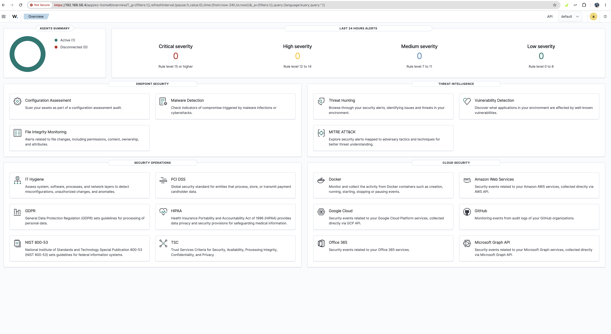
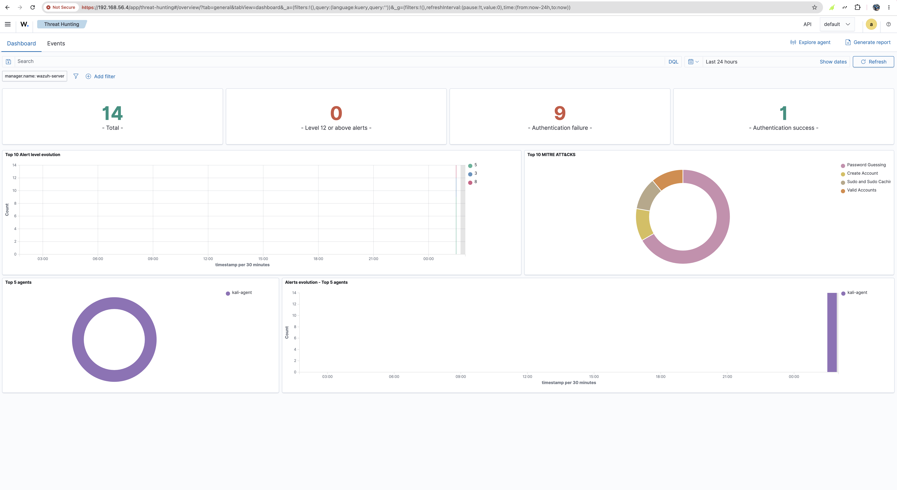
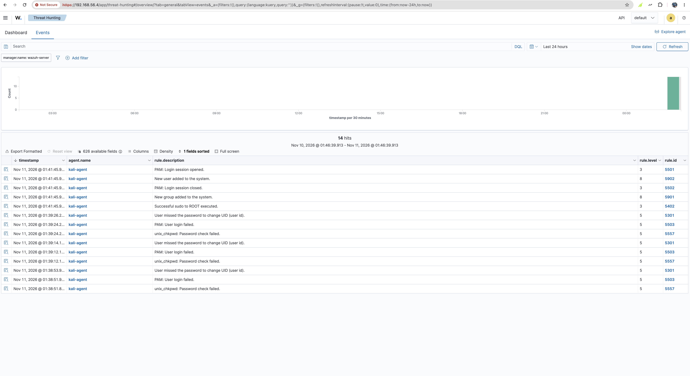
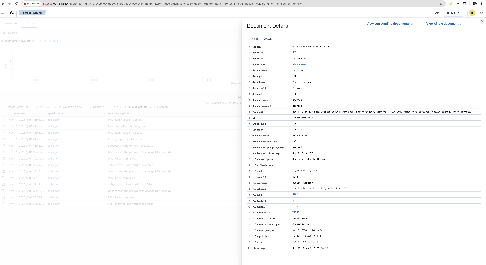

# Wazuh SOC Lab

A home lab project where I built a small security monitoring setup, created suspicious activity on purpose, and investigated the alerts the way a SOC analyst would.

**Date:** 11 November 2026
**Tools:** VirtualBox, Wazuh 4.14.9, Kali Linux

This is Project 2. [Project 1 was a vulnerability management lab](https://github.com/opeyemi11-giit/vulnerability-management-lab), where I scanned a weak machine and ranked the risks. This project is the next step: watching a machine and reacting to what happens on it.

---

## 1. Why I did this project

A SOC (Security Operations Centre) watches computers all day and reacts when something looks wrong. Most of that work is reading alerts and deciding if they matter.

I did this project to practise that myself. I wanted to set up the monitoring, cause some activity, find it in the alerts, and write it up clearly.

**What I wanted to learn:**
- How a SIEM collects logs from a machine
- What an alert looks like and how serious it is
- How alerts map to known attacker techniques
- How to write up what I found in plain language

## 2. Key terms

| Term | Meaning |
|---|---|
| **SIEM** | A system that collects logs from many machines into one place, looks for suspicious patterns and raises alerts |
| **Wazuh** | A free SIEM and security monitoring platform |
| **Agent** | A small program on a machine that sends its logs to the Wazuh server |
| **Rule level** | How serious an alert is, from 0 to 15 |
| **MITRE ATT&CK** | A list of known attacker tactics and techniques, with ID numbers |
| **IOC** | Indicator of compromise: a clue that something bad may have happened |
| **PICERL** | The steps of incident response: Preparation, Identification, Containment, Eradication, Recovery, Lessons learned |

## 3. How the lab works

I ran three virtual machines on one Mac using VirtualBox. Two are used in this project.

```
 +--------------+   logs (ports 1514/1515)   +---------------+
 | Kali Linux   | -------------------------> | Wazuh server  |
 | + Wazuh agent|      private host-only     | (dashboard)   |
 | .56.3        |         192.168.56.x       | .56.4         |
 +--------------+                            +---------------+
```

- **Wazuh server** runs the manager (which analyses logs), the indexer (which stores alerts) and the dashboard (the web page I read alerts on).
- **Kali Linux** is the machine being monitored. The Wazuh agent on it sends its logs to the server.
- Everything is on a private host-only network, so it stays separate from the internet and my home network.

| Machine | Role | IP address |
|---|---|---|
| Wazuh server | SIEM | 192.168.56.4 |
| Kali Linux 2026.3 | Monitored machine with agent `kali-agent` | 192.168.56.3 |
| Metasploitable 2 | From Project 1, not monitored yet | 192.168.56.2 |



## 4. What I did, step by step

1. **Imported Wazuh.** I downloaded the Wazuh OVA, which is a ready-made virtual machine, and imported it into VirtualBox.
2. **Put it on the private network.** It came set to Bridged, which uses my home Wi-Fi. I changed it to the host-only network.
3. **Opened the dashboard.** I went to `https://192.168.56.4` in Chrome and logged in.
4. **Installed the agent.** In the dashboard I chose Deploy new agent (DEB amd64, server 192.168.56.4, name `kali-agent`). I pasted the command into the Kali terminal.
5. **Started the agent.** I ran the three start commands from the dashboard and checked with `systemctl status wazuh-agent` that it was running.
6. **Checked it worked.** The dashboard showed **Active (1)** and **Disconnected (0)**.
7. **Created test activity on Kali.** I typed a wrong password three times for `su -`, then ran `sudo useradd testuser`.
8. **Investigated.** I opened Threat Hunting and read the alerts.

### Problems I solved

- **Dashboard errors from a full disk.** The dashboard showed red errors. The disk was 100% full, so the database made itself read-only. I shut the VM down, made the virtual disk bigger (25 GB to 60 GB), then used `growpart` and `xfs_growfs` so the system could use the new space.
- **"API is down" after starting.** The Wazuh manager had failed to start because the VM was slow after an unclean shutdown. I checked the service, restarted it, and used `wazuh-control status` to confirm the main parts were running.
- **Agent not pasting.** Clipboard sharing between my Mac and the VM was not working at first. I set Shared Clipboard to Bidirectional and pasted using the terminal's Edit menu.

## 5. What Wazuh found

After the test activity, the Threat Hunting dashboard showed **14 alerts**, all from `kali-agent`:

- **9** authentication failures
- **1** authentication success
- **0** alerts at level 12 or above

Its MITRE ATT&CK chart listed Password Guessing, Create Account, Sudo and Sudo Caching, and Valid Accounts.



### The alerts, in order

| Time (UTC) | What Wazuh saw | Rule ID | Level |
|---|---|---|---|
| 01:38 to 01:39 | PAM: User login failed | 5503 | 5 |
| 01:38 to 01:39 | unix_chkpwd: Password check failed | 5557 | 5 |
| 01:38 to 01:39 | User missed the password to change UID | 5301 | 5 |
| 01:41 | Successful sudo to ROOT executed | 5402 | 3 |
| 01:41 | **New user added to the system** | **5902** | **8** |
| 01:41 | New group added to the system | 5901 | 8 |

Each wrong password gave three alerts (5503, 5557 and 5301). That is why three attempts show nine failures.



## 6. Investigation ticket

**Ticket:** SOC-001
**Host:** kali-agent (192.168.56.3)
**Severity:** Medium (rule level 8)
**Status:** Closed, expected activity

**What happened:** A new user called `testuser` and a new group were created at about 01:41 on 11 November 2026. Before that, there were three failed password attempts for `su`.

**Verdict:** Not malicious. I did these actions myself for this lab. On a real server, a new account without an approved change would need to be escalated.

**Key evidence** (rule 5902):

```
Nov 11 01:41:37 kali useradd[38639]: new user: name=testuser, UID=1001, GID=1001, home=/home/testuser, shell=/bin/sh
```



**IOCs:**

| Type | Value |
|---|---|
| New account | testuser (UID 1001) |
| Home folder | /home/testuser |
| Command | `useradd`, run with `sudo` |
| Host | kali, 192.168.56.3 |

**MITRE ATT&CK:**

| Technique | ID | Tactic |
|---|---|---|
| Create Account | T1136 | Persistence |
| Password Guessing | T1110.001 | Credential Access |
| Sudo and Sudo Caching | T1548.003 | Privilege Escalation |
| Valid Accounts | T1078 | Defence Evasion, Persistence |

Wazuh tagged rule 5902 as **T1136 Create Account, Persistence** directly. I added the IDs for the other three from their names on the chart.

**Response steps (PICERL):**

| Step | What I did or would do |
|---|---|
| Preparation | Installed the Wazuh agent so the host sends logs |
| Identification | Wazuh raised rules 5902 and 5901 (new account) and 5503, 5557 and 5301 (failed logins) |
| Containment | In a real case: disable the account and isolate the host |
| Eradication | Remove the account with `sudo userdel testuser` |
| Recovery | Check there are no other new accounts or changes |
| Lessons learned | Alert on new accounts outside approved changes, and watch repeated failed logins |

**Next steps in a real incident:**
- Find who ran `useradd` and from which session
- Look for other activity from the same user around the same time
- Check there was an approved change request
- Disable the account if it was not approved

## 7. Limits of this project

- All the activity was created by me, so this is lab data and not a real incident.
- Only Kali has an agent. Metasploitable is not monitored yet.
- I used the default Wazuh rules and did not write any of my own.
- An nmap scan from Kali would not be seen by the agent on Kali, because the agent reads logs from its own machine. To catch scans I would need network monitoring.

## 8. What I learned

- Building a SIEM lab and connecting an agent
- Reading alerts, rule IDs and severity levels
- Mapping alerts to MITRE ATT&CK
- Fixing real problems: a full disk and a service that failed to start
- Writing a clear ticket with a verdict, evidence and next steps

## 9. What I plan next

- Add an agent to Metasploitable 2 and watch it while I attack it
- Try an SSH brute-force test and see how Wazuh reports it
- Write a custom detection rule
- A phishing email analysis write-up
- A mock incident report

## Screenshots

All screenshots are in the [`evidence`](evidence) folder.
